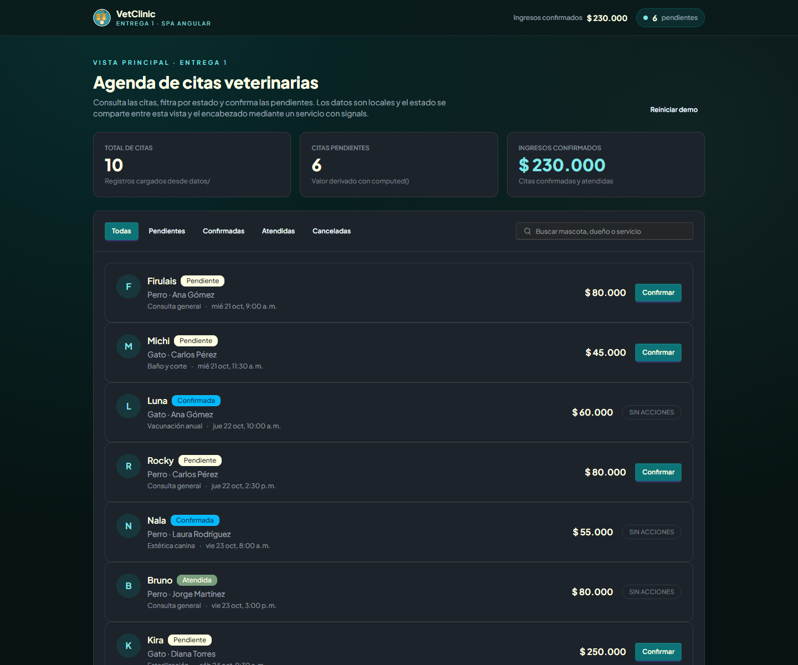
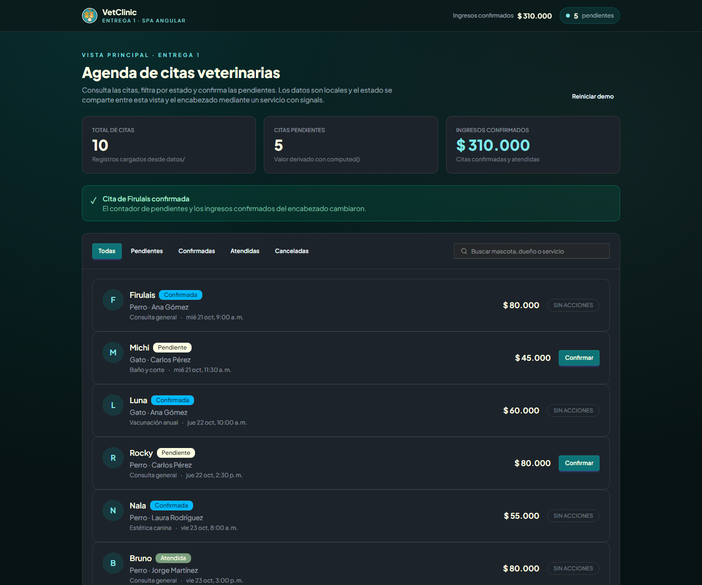
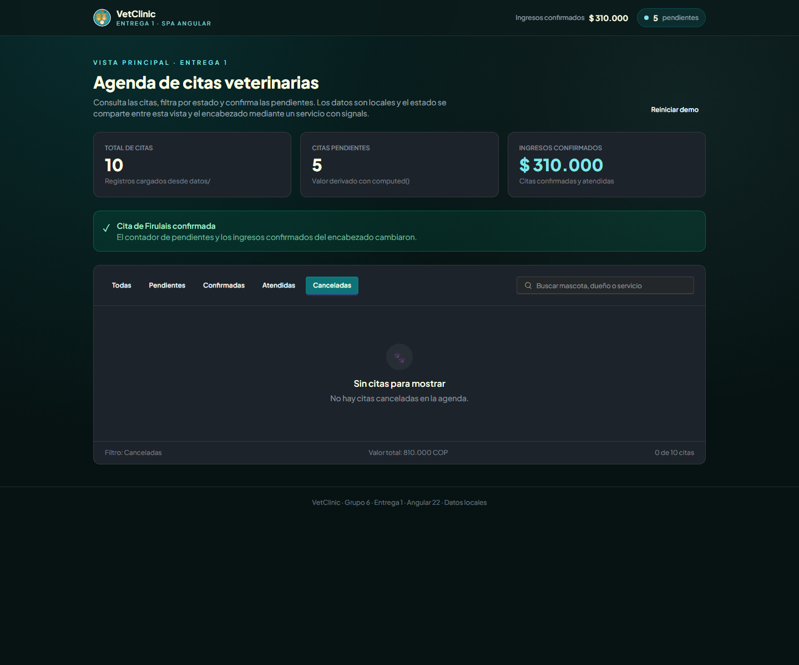

# VetClinic — SPA Angular 22

Aplicación web para la gestión de una clínica veterinaria: clientes, mascotas, citas, servicios, facturas y pagos. El proyecto está construido con **Angular 22** (componentes standalone, signals y control de flujo moderno) y se conecta a una API REST para el funcionamiento completo de la clínica.

La **Entrega 1** del proyecto integrador se demuestra en una vista pública con datos locales: **`/entrega-1`**.

## Integrantes

- Victor Martinez
- Francisco Garrido

**Grupo:** 6

## Dominio y entidad principal

- **Dominio:** clínica veterinaria (VetClinic).
- **Entidad principal de la entrega:** **Cita**, identificada por `id`, con mascota, propietario, servicio, fecha/hora, precio y estado (`PENDIENTE`, `CONFIRMADA`, `ATENDIDA`, `CANCELADA`).
- **Acción del usuario:** confirmar una cita pendiente. Al hacerlo cambian el estado de la cita, el total de pendientes y los ingresos confirmados.

## Demo de la Entrega 1

| Entorno | URL |
| --- | --- |
| Local | http://localhost:4200/entrega-1 |
| Producción | https://veterinaria-one-nu.vercel.app/entrega-1 |

La ruta es **pública** (no requiere iniciar sesión) y usa exclusivamente datos locales de `src/app/datos/citas-demo.ts`. No llama a la API, de modo que la demostración funciona sin backend.

Qué se puede ver:

- 10 citas locales, filtros por estado y búsqueda por mascota, propietario o servicio.
- Indicadores derivados con `computed()`: total de citas, citas pendientes e ingresos confirmados.
- Encabezado de la página que lee el **mismo servicio** y refleja los cambios de estado.
- Botón **Confirmar** en cada cita pendiente (`output()` del componente hijo).
- Caso límite visible: al filtrar **Canceladas** no hay registros y se muestra el bloque `@empty`.
- Pipes `currency`, `date` y `number` con locale `es-CO`, y el pipe propio `estadoCita`.

Valores iniciales de la demostración: **10 citas**, **6 pendientes** e **ingresos confirmados de $ 230.000**. Al confirmar la cita de Firulais quedan **5 pendientes** y los ingresos suben a **$ 310.000**.

## Cómo ejecutar

Requisitos: Node.js 20 o superior y npm.

```bash
npm install
npm start
```

Abrir `http://localhost:4200/entrega-1`.

Compilar para producción (debe terminar sin errores):

```bash
npx ng build
```

La aplicación autenticada se sirve en `http://localhost:4200/` y consume la API configurada en `src/environments/` / `proxy.conf.json`. La demo de la entrega no depende de esa API.

## Estructura del proyecto

La entrega usa la estructura de carpetas solicitada para el modelo, los datos, el servicio y los pipes. El resto de la aplicación conserva las capas `core/`, `features/`, `shared/` y `layouts/`.

```text
src/app/
├── modelos/
│   └── cita-demo.ts                 # Interfaz CitaDemo y tipo EstadoCitaDemo
├── datos/
│   └── citas-demo.ts                # 10 registros locales (sin CANCELADA)
├── servicios/
│   └── citas-demo.service.ts        # Dueño del estado; signal privada + asReadonly()
├── pipes/
│   └── estado-cita.pipe.ts          # Pipe propio del dominio
├── componentes/
│   └── entrega1/
│       ├── entrega1-page/           # Página pública /entrega-1
│       ├── demo-header/             # Encabezado; lee el mismo estado
│       ├── entrega1-view/           # Vista principal, filtros y resumen
│       └── cita-demo-card/          # Hijo repetido; input.required() + output()
├── core/
│   ├── models/                      # Modelos de la API
│   ├── services/                    # Servicios HTTP y AuthService
│   ├── guards/                      # authGuard, guestGuard, permisosGuard
│   ├── interceptors/                # authInterceptor
│   └── utils/
├── shared/
│   └── components/                  # DataTable, SearchSelect, ConfirmDialog, etc.
├── layouts/
│   ├── auth-layout/
│   └── default-layout/
├── features/
│   ├── auth/  dashboard/  citas/  clientes/  mascotas/
│   ├── facturas/  pagos/  servicios/  empleados/  admin/
└── app.routes.ts
```

## Árbol de componentes

```text
App
├── AuthLayoutComponent                         (/login, /register, /activate-account)
│   ├── LoginComponent
│   ├── RegisterComponent
│   └── ActivateAccountComponent
├── DefaultLayoutComponent                      (rutas autenticadas, authGuard)
│   ├── DashboardComponent
│   ├── CitasListComponent → CitaFormComponent, CitaDetailComponent,
│   │                        MisCitasComponent, ConsultaFormComponent,
│   │                        EsteticaFormComponent, ClienteCitaFormComponent
│   ├── ClientesListComponent → ClienteFormComponent, ClienteDetailComponent, MiPerfilComponent
│   ├── MascotasListComponent → MascotaFormComponent, MascotaDetailComponent, MisMascotasComponent
│   ├── FacturasListComponent → FacturaDetailComponent, MisFacturasComponent
│   ├── PagosListComponent → PagoDetailComponent
│   ├── ServiciosListComponent
│   ├── EmpleadosListComponent → EmpleadoFormComponent, EmpleadoDetailComponent
│   └── RolesComponent, PermisosComponent
│
├── DataTableComponent, SearchFilterComponent, SearchSelectComponent,
│   PaginationBarComponent, ConfirmDialogComponent, LoadingSpinnerComponent,
│   CalendarDayPickerComponent                   (componentes compartidos)
│
└── Entrega1PageComponent                       (ruta pública /entrega-1)
    ├── DemoHeaderComponent                     (lee CitasDemoService)
    └── Entrega1ViewComponent                   (vista principal)
        └── CitaDemoCardComponent × 10          (@for con track cita.id)
```

## Contratos de los componentes

Los componentes de página de `features/` son destinos de ruta: no declaran `input()`/`output()`; reciben parámetros por la URL e interactúan con la API mediante servicios. La tabla cubre los componentes de la entrega y los componentes compartidos que sí exponen un contrato.

| Componente | Tipo | Inputs | Outputs | Uso |
| --- | --- | --- | --- | --- |
| `Entrega1PageComponent` | Página | — | — | Compone el encabezado y la vista de la entrega. |
| `DemoHeaderComponent` | Encabezado | — | — | Inyecta `CitasDemoService`; muestra `totalPendientes()` e `ingresosConfirmados()`. |
| `Entrega1ViewComponent` | Vista | — | — | Inyecta el servicio; filtra, busca y confirma citas. |
| `CitaDemoCardComponent` | Hijo | `cita: CitaDemo` (**required**) | `confirmar: number` | Se repite con `@for`; emite el id al padre. |
| `DataTableComponent<T>` | Compartido | `columns: DataTableColumn[]` (required), `data: T[]` (required), `loading: boolean`, `emptyMessage: string`, `dimInactive: boolean` | `sort: string` | Tabla reutilizable con celdas y acciones proyectadas. |
| `CellTemplateDirective` | Directiva | `key: string` (alias `appCell`, required) | — | Plantilla de celda por columna. |
| `ActionsTemplateDirective` | Directiva | — | — | Plantilla de acciones por fila. |
| `SearchSelectComponent` | Compartido | `value` (model), `options: SearchSelectOption[]`, `placeholder?: string`, `required: boolean`, `disabled: boolean` | — | Selector con búsqueda. |
| `ConfirmDialogComponent` | Compartido | `title?: string`, `message: string` (required), `confirmText?: string`, `cancelText?: string`, `variant?: 'primary' \| 'error' \| 'warning' \| 'success'` | `confirm: void`, `cancel: void` | Diálogo de confirmación. |
| `SearchFilterComponent` | Compartido | `value` (model), `placeholder?: string` | `search: void` | Campo de búsqueda con evento. |
| `PaginationBarComponent` | Compartido | `page` (model, required), `totalPages: number`, `totalElements: number`, `size: number` | — | Paginación reutilizable. |
| `CalendarDayPickerComponent` | Compartido | `value` (model), `idEmpleado?: number`, `tipoServicio?: string`, `minDate?: string` | — | Calendario de disponibilidad. |
| `LoadingSpinnerComponent` | Compartido | `title?: string` | — | Indicador de carga. |
| `DefaultLayoutComponent` | Layout | — | — | Shell autenticado con sidebar, header y `router-outlet`. |
| `AuthLayoutComponent` | Layout | — | — | Shell de autenticación con `router-outlet`. |

## Estado: dueño y justificación

| Estado | Dueño | Justificación |
| --- | --- | --- |
| Citas de la demo (`CitaDemo[]`) | `CitasDemoService` (`providedIn: 'root'`) | Es el único estado que debe compartirse entre la vista y el encabezado de la entrega. Vive en un servicio singleton para que ambos componentes lean y reaccionen a la misma fuente de verdad. La señal es privada, se expone con `asReadonly()` y solo se modifica con `confirmarCita()` y `reiniciarDemo()` mediante actualizaciones inmutables. |
| Valores derivados de la demo (`totalCitas`, `totalPendientes`, `ingresosConfirmados`) | `CitasDemoService` | Son `computed()` que dependen de la señal de citas. Al confirmar una cita se recalculan automáticamente y se reflejan tanto en la vista como en el encabezado. |
| Sesión, token y permisos | `AuthService` | Estado transversal a guards, interceptor y layout. Se mantiene fuera de las páginas para no duplicarlo; expone señales de solo lectura y métodos de login/logout. |
| Datos del servidor (clientes, mascotas, citas reales, facturas, pagos, servicios, empleados) | Servicios API (`CitasApiService`, `ClientesApiService`, etc.) | Son pasarelas HTTP sin estado de UI: devuelven `Observable<T>` y no guardan la lista. Cada página decide si cachea, filtra o pagina localmente. |
| Filtro, búsqueda y mensaje de la demo | `Entrega1ViewComponent` | Es estado efímero de la vista; no lo necesita el encabezado ni otra ruta. Se mantiene local con `signal()`/`computed()`. |
| Estado de tablas, diálogos y formularios | Componentes de página / compartidos | Es estado de presentación o de formulario. Se comunica con `input()`/`output()`/`model()` y no representa estado global del dominio. |

## Criterios de la entrega

| Criterio | Dónde se cumple |
| --- | --- |
| **R1** README con integrantes, dominio, ejecución, árbol, contratos y dueño del estado | Este archivo. |
| **R2** ≥ 3 componentes propios; hijo repetido con `@for`, `input.required()` y `output()` | `Entrega1PageComponent`, `DemoHeaderComponent`, `Entrega1ViewComponent` y `CitaDemoCardComponent`; el hijo se repite en `entrega1-view.component.ts` con `@for (cita of citasFiltradas(); track cita.id)`. |
| **R3** Servicio root, señal privada + `asReadonly()`, métodos con nombre, `computed` visible y encabezado leyendo el mismo estado | `src/app/servicios/citas-demo.service.ts`; `DemoHeaderComponent` lee `totalPendientes()` e `ingresosConfirmados()`. |
| **R4** `@if`, `@for` con `track`, `@empty`, `@switch`, pipes `es-CO` y pipe propio | `entrega1-view.component.ts` y `cita-demo-card.component.ts`; `estado-cita.pipe.ts`; locale `es-CO` registrado en `app.config.ts`. |
| **R5** Interfaz en `modelos/`, ≥ 8 registros en `datos/`, caso límite visible | `src/app/modelos/cita-demo.ts` (interfaz) y `src/app/datos/citas-demo.ts` (10 registros). El filtro **Canceladas** produce el `@empty` visible. |
| **R6** Estructura, repo público, sin `node_modules`, commits y PDF | Estructura de `modelos/`, `datos/`, `servicios/`, `pipes/` y `componentes/entrega1/`; `.gitignore` excluye `node_modules`; repositorio público; el PDF se entrega en el aula. |

## Evidencias

### Captura 1 — Estado inicial

Vista principal con los 10 registros locales, 6 citas pendientes, ingresos confirmados por $ 230.000 y el encabezado leyendo el mismo estado.



### Captura 2 — Después de confirmar una cita

Se confirmó la cita de Firulais. El encabezado y los indicadores derivados cambiaron: 5 pendientes e ingresos por $ 310.000; la tarjeta muestra el nuevo estado `CONFIRMADA`.



### Captura 3 — Caso límite `@empty`

Al filtrar **Canceladas** no hay registros. Se muestra el bloque `@empty` y el pie confirma que hay 0 de 10 citas para ese filtro. (Evidencia adicional de R5.)



## Verificación

```bash
npx ng build
git shortlog -sn
```

El build de producción termina sin errores. El repositorio no incluye `node_modules`; se instala con `npm install`.

## Repositorio

https://github.com/IngVictor2/veterinaria_fronted

## Despliegue

El proyecto se despliega en Vercel a partir de la rama `main`. La vista de la entrega queda disponible en:

https://veterinaria-one-nu.vercel.app/entrega-1
